# Riverside General Hospital — Management System

A hospital management dashboard I built for practice: a **React** single-page app talking to a **Laravel** REST API.
It has four roles (admin, receptionist, doctor, patient), each with its own views, and it works in **English, Kurdish (Sorani) and Arabic**, including a full right-to-left layout.

> **Hobby project.** The hospital, people and data are entirely fictional and generated by a seeder.
> It has no automated tests and isn't hardened for production use.

<p align="center">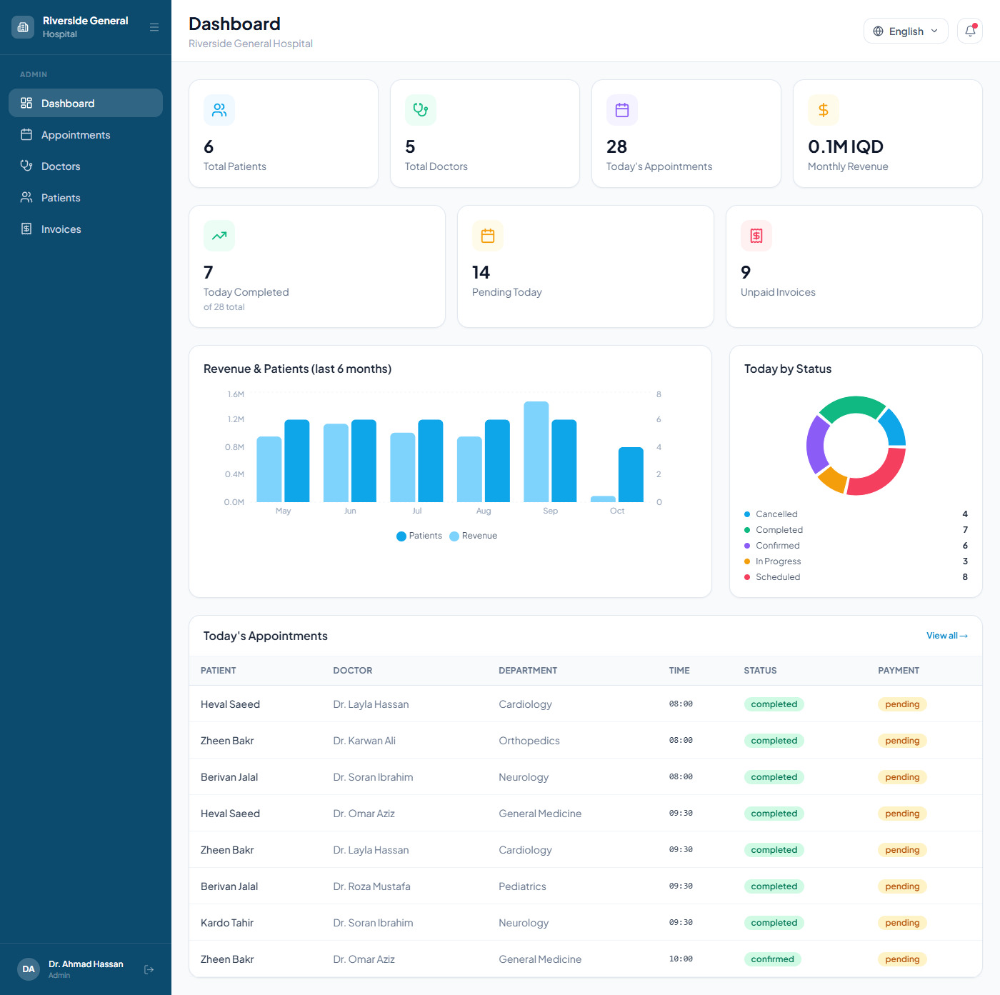</p>

## Features
- **Role-based portals** — separate navigation and pages for admin, receptionist, doctor and patient
- **Dashboard** — live stats, six-month revenue/patients chart, today's appointments by status
- **Appointments** — booking with available time slots, status updates, search and filters
- **Doctors & patients** — directory, search, add a doctor, patient history
- **Medical records & prescriptions** — doctors write records and prescriptions after a visit; patients view them
- **Billing** — invoices, mark as paid (cash / card / insurance / bank), collected vs. outstanding totals
- **PDF export** — downloadable invoices and prescriptions
- **English, Kurdish (Sorani) and Arabic** — language menu, full right-to-left layout, localized dates and fonts (see [Languages](#languages))
- **Responsive** — works on phones and tablets (slide-out menu, scrollable tables)
- **Notifications** — bell shows what needs attention for the current role

## Tech stack
| | |
|---|---|
| Frontend | React 19, Vite, React Router, TanStack Query, Tailwind CSS, Recharts, Axios, i18next |
| Backend | Laravel 13, Sanctum token auth, SQLite, DomPDF |

## Screenshots

**English**

<p>
  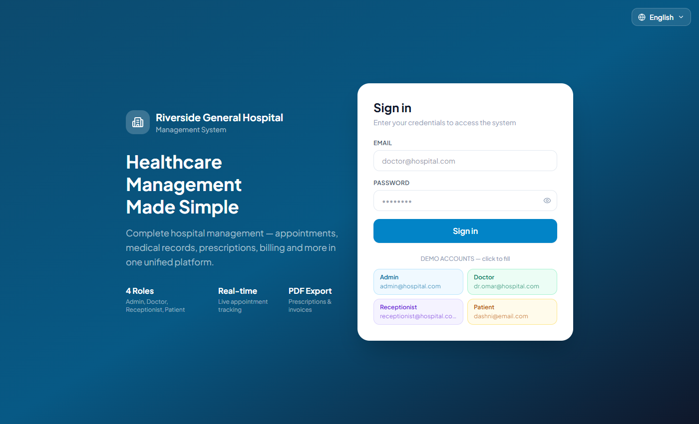
  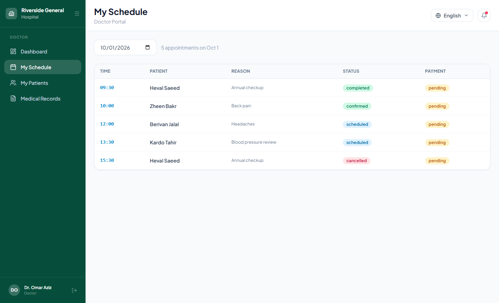
  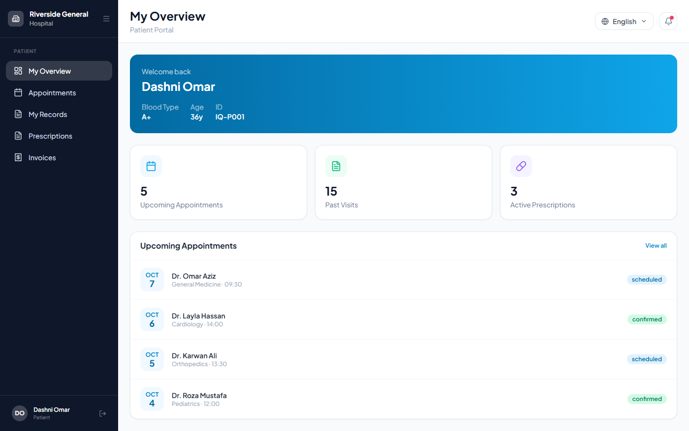
</p>
<p>
  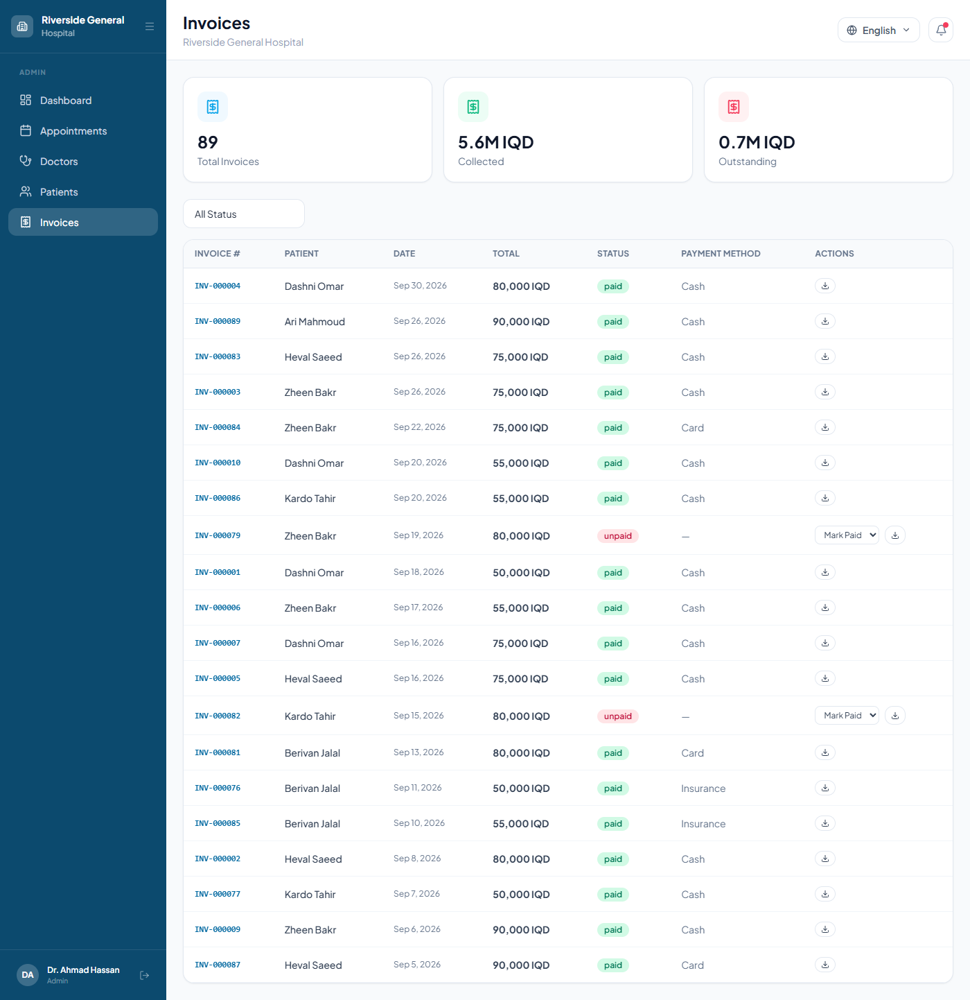
  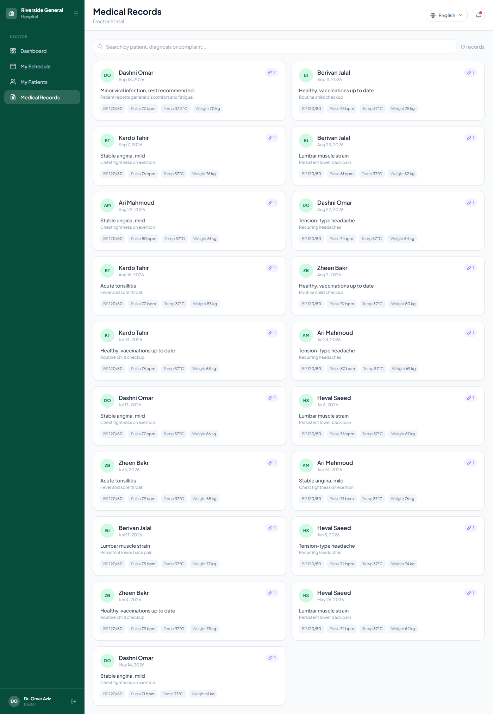
  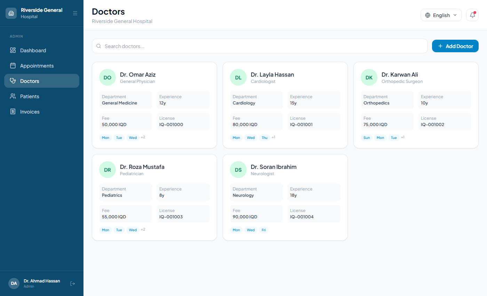
</p>

**Kurdish (Sorani) and Arabic — right-to-left**

<p>
  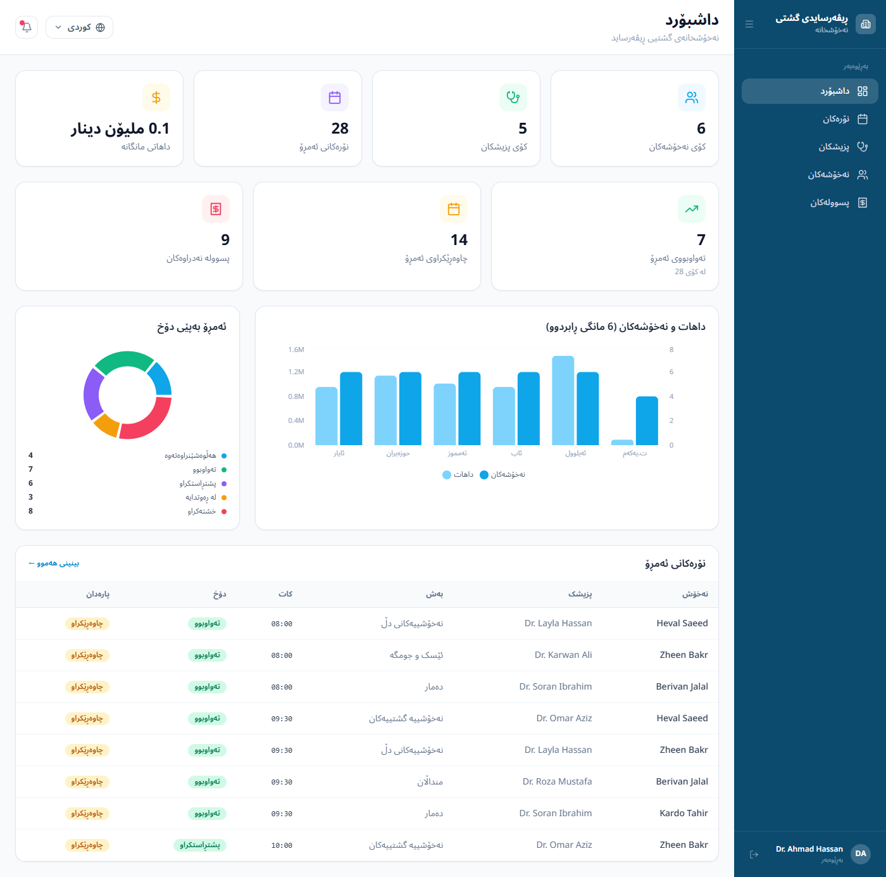
  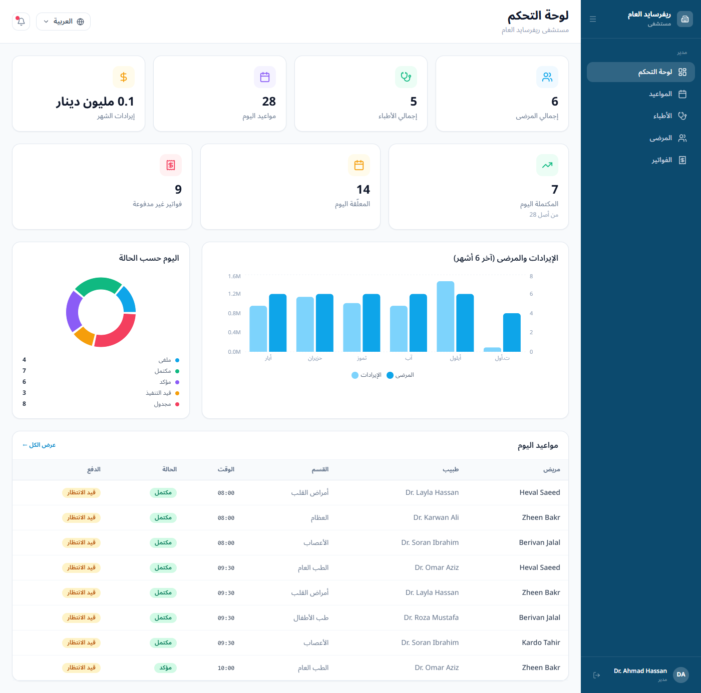
</p>

**On a phone** (English, Kurdish, Arabic, and the slide-out menu)

<p>
  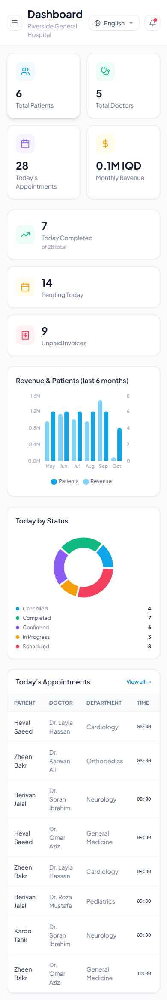
  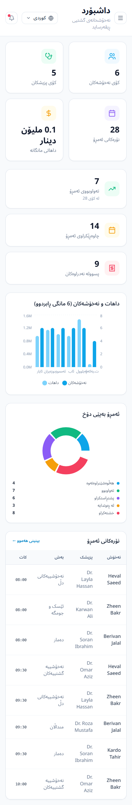
  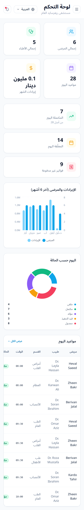
  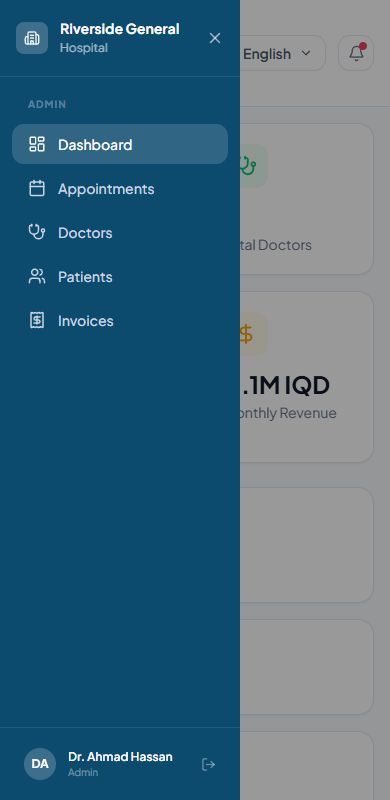
</p>

More in [`screenshots/`](screenshots/) — every page for each role in English, plus the same in [Kurdish](screenshots/kurdish/) and [Arabic](screenshots/arabic/), each with a `mobile/` folder.

## Run it locally

**Requirements:** PHP 8.4+ (with `pdo_sqlite`, `mbstring`, `openssl`, `fileinfo`, `zip`, `curl`), Composer, Node.js 20+

**1. Backend** — http://localhost:8000
```bash
cd hospital-backend
composer install
cp .env.example .env           # Windows: copy .env.example .env
php artisan key:generate
touch database/database.sqlite   # Windows: type nul > database\database.sqlite
php artisan migrate --seed       # creates the demo users and data
php artisan serve
```

**2. Frontend** — http://localhost:5173
```bash
cd frontend
npm install
npm run dev
```
The API address comes from `frontend/.env` (`VITE_API_URL`, default `http://localhost:8000/api`).

## Demo accounts
Password for all of them is `password`.

| Role | Email |
|---|---|
| Admin | admin@hospital.com |
| Receptionist | receptionist@hospital.com |
| Doctor | dr.omar@hospital.com |
| Patient | dashni@email.com |

In dev builds the login page has one-click buttons for these. `php artisan migrate:fresh --seed` resets the demo data.

## Languages
Use the language menu in the top bar (or on the login page) to switch between **English**, **کوردی (Sorani Kurdish)** and **العربية (Arabic)**. The choice is remembered, and the layout flips to right-to-left automatically.

- Translations live in [`frontend/src/i18n/ckb.json`](frontend/src/i18n/ckb.json) (Kurdish) and [`frontend/src/i18n/ar.json`](frontend/src/i18n/ar.json) (Arabic). The English text is the key, so anything missing simply shows in English.
- The translations were written with AI assistance and **haven't been reviewed by a native speaker** — corrections are very welcome, just edit the JSON files.
- To add another language, add a JSON file next to them, register it in `frontend/src/i18n/index.js` (`LANGUAGES` and `resources`), and translate the keys.
- The demo data (patient and doctor names, medicine names) is seeded in Latin script; only the interface and the common clinical phrases are translated. Downloadable PDFs are English-only for now.
- Numbers are shown with Western digits (1, 2, 3) in every language, so they match the data and prices.

## Project layout
```
frontend/          React app (src/pages per role, src/components, src/services/api.js, src/i18n)
hospital-backend/  Laravel API (app/Http/Controllers, app/Models, database/seeders, routes/api.php)
screenshots/       Screenshots used in this README
```
